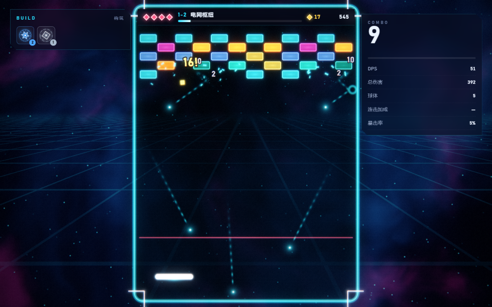
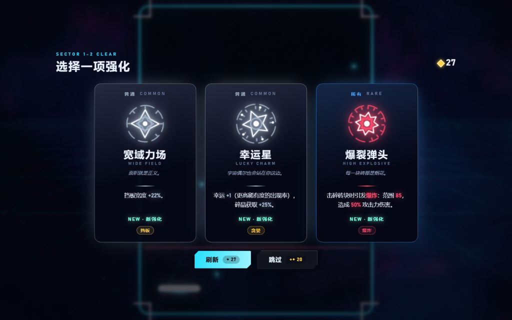
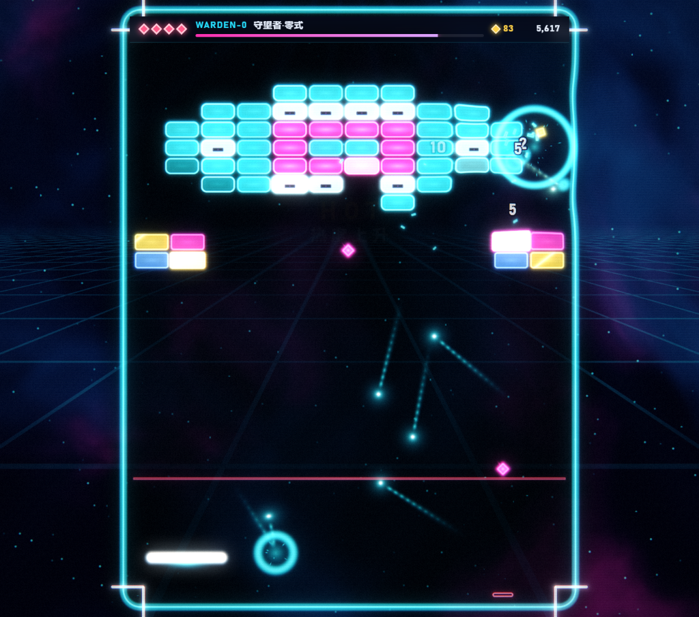
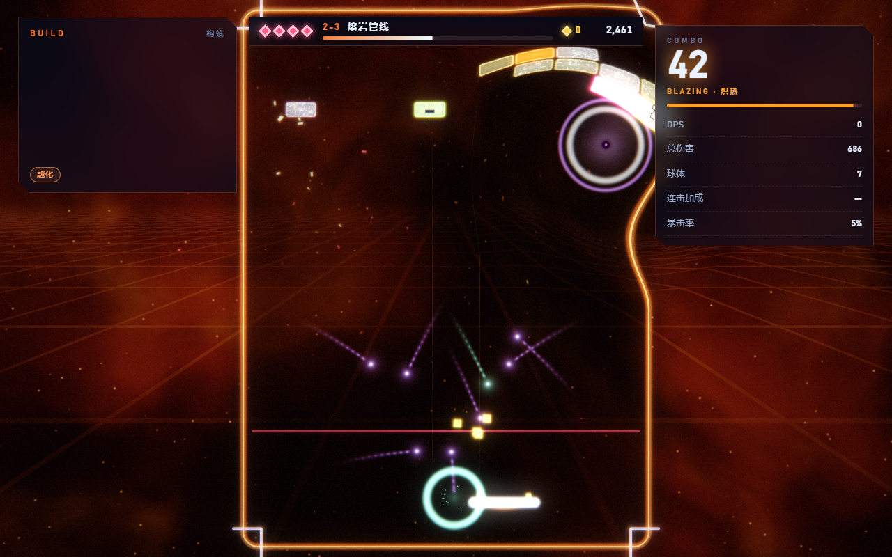

[中文](README.md) | English

# 碎界 SHATTERVERSE

**SHATTERVERSE (碎界)** is a **zero-runtime-dependency roguelite brick-breaker web game** built with **TypeScript, a custom WebGL2 instanced SDF rendering pipeline, and Web Audio synthesized sound**. It supports **中文 / English / 日本語 / 한국어** in Settings (Chinese by default) and runs instantly in desktop and mobile browsers.

**Play online: <https://ikaros-521.github.io/SHATTERVER/>** — pushing to `main` builds and deploys automatically via GitHub Actions.

The core design goal is "game feel": every hit gets a response, builds grow endlessly toward the absurd, and the screen stays readable at 60 fps even when hundreds of balls, black holes, and chain explosions fill it.

## Screenshots

|                                              Multiball Arcade Combat                                              |                                                  Roguelite 3-Choice Draft                                                  |
| :---------------------------------------------------------------------------------------------------------------: | :------------------------------------------------------------------------------------------------------------------------: |
|   |                              |
|                                       **Multi-Part Boss Fight (Warden-0)**                                        |                                               **Late-Game Elemental Chaos**                                                |
|  |  |

## Quick Specs

| Aspect        | Details                                                                                                                                 |
| ------------- | --------------------------------------------------------------------------------------------------------------------------------------- |
| Genre         | Roguelite Brick-Breaker / Arkanoid Roguelike                                                                                            |
| Platform      | Any browser with WebGL2 hardware acceleration (desktop + portrait mobile touch, 0 MB instant play)                                      |
| Tech Stack    | TypeScript, custom WebGL2 pipeline (~10 draw calls/frame), procedural Web Audio SFX & music                                             |
| Runtime Deps  | **0** (zero production npm dependencies; builds to purely static `dist/`)                                                               |
| Content Scale | 15 Campaign sectors (3 chapters × 5 + 3 bosses) + Endless, 56 upgrades, 17 power-ups, 4 starters, 4 elemental reactions, 5 difficulties |
| Leaderboards  | Local top-50 history + optional cloud boards (CheddaBoards / Bilibili Toy) + shareable PNG score card                                   |

## Getting started

Requires Node.js ≥ 20.19.

```bash
pnpm install        # or npm install
pnpm dev            # dev server, default http://127.0.0.1:5173
pnpm build          # typecheck + production build, output to dist/
pnpm preview        # preview the production build locally
pnpm test           # unit tests + headless-bot balance simulation
pnpm lint           # ESLint
pnpm format         # Prettier
```

`dist/` is purely static and can be served by any static server.

Browser requirements: **WebGL2** with hardware acceleration (current Chrome / Edge / Firefox are all fine). A clear fallback page shows up when WebGL2 is missing.

## Controls

| Action                                | Effect                                                                     |
| ------------------------------------- | -------------------------------------------------------------------------- |
| Move the mouse                        | Steer the paddle (`A`/`D`, `←`/`→` and touch dragging also work)           |
| `Space` / mouse click / prompt button | **Overdrive**: when the meter is full, seconds of boosted damage and speed |
| `P` / `Esc`                           | Pause                                                                      |
| Draft screen: `1` `2` `3` / `R` / `S` | Pick / reroll / skip                                                       |

Portrait phones get a dedicated layout: shield, level and score collapse into the top bar, build icons into the bottom bar, the combo counter floats over the arena's top-right with the overdrive button above it; switching apps or losing focus auto-pauses. Touch devices also skip the panels' frosted-glass blur (the compositor recalculates it every frame — the most expensive UI effect on phones) in favor of a more opaque fill.

The game auto-pauses when the window loses focus.

## License

This project uses a custom non-commercial license (see [LICENSE](./LICENSE)). In short:

- **Play freely**: playing, copying and distributing are free, no permission needed;
- **Remixing allowed**: personal learning/hobby modifications and derivatives are fine, but the complete source must be published under the same license with the original author credited;
- **No commercial use**: it must not be used for profit in any form (sales, ads, in-app purchases, paid platforms, etc.);
- **Commercial use requires permission**: any commercial use needs the author's prior written consent (reach out via a repo issue or private message).

## How it plays

- **Balls are never lost.** A ball that reaches the bottom relaunches from the paddle shortly after. Catching with **different parts of the paddle** steers the return angle; a dead-center catch is a "perfect catch" and charges the most.
- **The brick wall sinks.** Bricks past the red warning line shatter and cost one shield. At zero shields the run ends.
- **Intercept barrages with the paddle.** Turret and boss barrages only cost shield when they slip past the bottom; balls and lasers can destroy them too.
- **Every cleared level, a three-way draft.** Crystals reroll the options, or skipping banks more crystals.
- **Power-up capsules.** Shattered bricks drop capsules now and then: ball splits, giant balls, a longer paddle, time stop, rage… A capsule falls straight down — catch it on the paddle or it is gone (a magnet pulls it in). A caught one lasts a few seconds, for the current level only. A wall closing on the warning line is offered more of what tears it down, and a low shield sees repair come round sooner. The **Resonance** school of upgrades is built around them.
- **Pick your difficulty**: 5 tiers (Standard → Abyss) at the starter screen. Higher tiers sink the wall faster, thicken brick health and count, narrow the paddle, suppress ball speed, densify barrages; Hard and above field **ball-eating eraser bricks**, and Abyss erases one surplus ball every 16 seconds. Higher tiers multiply score ×1.5–×4 — leaderboard rank is bought with difficulty.
- **Records stay local.** Every run lands on the local leaderboard (main menu → Records, ranked by score); the results screen can **save a score card** — a shareable PNG of the final frame with all the numbers and the final build.
- Owning two elements unlocks **elemental reactions** automatically: Melt (frost+flame), Overload (flame+shock), Superconduct (frost+shock), Venom Burst (corrode+flame).

### Content scale

| Content           | Count                    | Notes                                                                                                                                      |
| ----------------- | ------------------------ | ------------------------------------------------------------------------------------------------------------------------------------------ |
| Upgrades          | 56                       | 5 rarities (common / rare / epic / legendary / mythic); mythics presuppose their school's build; 5 of them belong to the Resonance school  |
| Power-ups         | 17                       | 15 timed (ball split, giant, wide, time stop…) + 2 instant; dropped as capsules by shattered bricks, they last for the current level only  |
| Starter protocols | 4                        | Blank, Barrage, Battery, Elemental — each sets a run's starting point                                                                      |
| Levels            | 3 chapters × 5 + Endless | 12 brick patterns and pixel motifs, a boss every 5 sectors; Endless loops and escalates forever                                            |
| Level mutators    | 6                        | Gravity Well, Overpressure, Regenerating, Cloaked, Flak Zone, Gold Rush                                                                    |
| Bosses            | 3                        | Multi-part pixel bosses: turrets, cores, phase shifts, summons, enrage                                                                     |
| Combo tiers       | 9                        | HOT → BEYOND, driving music intensity and screen feedback                                                                                  |
| Local leaderboard | Last 50 local runs       | Grouped by mode, ranked by score, saved to localStorage with the best records                                                              |
| Difficulty tiers  | 5                        | Standard / Advanced / Hard / Nightmare / Abyss: descent, health, brick count, paddle, barrages, eraser bricks, ball erasure; score ×1 → ×4 |

## Design pillars

1. **Game feel first.** Frame hits, trauma-style screen shake, spring zoom, slow motion, shockwave refraction, synthesized SFX that pitch up with the combo — every hit is a small production.
2. **Absurd but readable.** Builds can reach 18 balls, chain supernovas, black holes and time stops on screen at once. Every large effect carries a budget and a cap (per-frame explosion quota, HDR compression, merged damage numbers), so spectacle never degrades into a white screen.
3. **Decisions with depth.** The draft tilts toward schools you already own without forcing them; legendaries and mythics are a build's destination, not a lottery.

## Technical architecture

Simulation and presentation are strictly separated. `src/game/` touches no DOM and no WebGL and runs headless in Node — unit tests, balance sims and the browser all execute the same code.

```
src/
  core/        RNG (reproducible seeds), event bus, math, save data
  game/        Pure logic: world simulation, physics, damage pipeline, upgrades, power-ups, level generation, session
  render/      WebGL2 renderer, SDF instanced shaders, post chain, FX director, camera
  audio/       Web Audio synthesis engine, SFX recipes, procedural music, audio director
  ui/          DOM UI: HUD, draft, codex, results, settings, i18n
  app.ts       Application layer: state machine, input, main loop
```

- **Simulation**: continuous collision between swept circles and AABBs (no ball ever tunnels through), death effects processed through a queue so chain reactions iterate instead of recursing, and damage sources split into ball / secondary / damage-over-time / area to keep trigger chains controlled.
- **Rendering**: every scene object is an instance of one instanced SDF shader, one draw call per blend mode; a full frame is about 10 draws. HDR float render target → bright pass → two-pass Gaussian blur → composite (bloom, chromatic aberration, shockwave refraction, gravitational lensing, radial blur, glitch, ACES tone mapping, vignette, grain).
- **Audio**: no audio files at all. SFX are recipes of oscillators and filtered noise; music is a 16-step sequencer scheduled frame-ahead; reverb comes from procedurally generated impulse responses. The sequencer's look-ahead window is 450 ms with a slow timer as a backstop feed — the music keeps playing when animation frames are throttled (notification banners, backgrounded tabs) and recovers by itself after the audio context is interrupted (calls, alarms). **Frame rate never affects sound**: audio runs on its own thread, and cutting SFX would not buy smoothness — only lose feedback.
- **Adaptive quality**: the effects layer counts per-frame events and converges emission rates while merging damage numbers. On top sits the quality governor (`src/render/governor.ts`): in a 100-frame judgement window, if more than 80% of frames are late (below ~36 fps), it steps down the ladder "high → medium → low → low (75% render resolution)" — on high-density screens each step draws roughly half the pixels, and pixel count is what GPU time follows. **Every step must prove itself useful**: the window after a step-down must show a mean frame time at least 15% shorter than the one that triggered it, or the step is not kept for the device (which would otherwise start there next time). If consecutive step-downs buy nothing, the frame rate is judged not to be GPU-bound (typically a system power saver pinning the page at 30 fps), the player's chosen quality is restored and automatic adjustment stops. The settings page states the step actually in effect.
- **Idle screens redraw rarely**: pause, draft and results are static, so those screens redraw at about 15 fps — a phone does not keep cooking behind a dialog box, saving thermal headroom for the fight ahead.

### Balance method

`tests/balance.test.ts` has the built-in bot (near-perfect catching and barrage interception) play 8 full campaigns per drafting persona across four personalities, reporting per-level time medians / P95 / max and damage taken, with regression assertions on pacing. The bot is the ceiling; the drafting personas represent player build skill. Current results: level 1 takes about 17 seconds, a full campaign about 5 minutes, and the four personas' clear rates are 100% / 100% / 88% / 75%.

### Debug interface

The page exposes `window.__shatterverse` for automated inspection and tuning:

| Method                                 | Description                                                                                                                                        |
| -------------------------------------- | -------------------------------------------------------------------------------------------------------------------------------------------------- |
| `state()`                              | Snapshot of current state (level, combo, boss, draw stats, fps, audio state…)                                                                      |
| `advance(seconds)`                     | Advances the simulation and draws one frame without real-time frames                                                                               |
| `freeze(on)`                           | Freezes the simulation, for capturing an exact frame                                                                                               |
| `autopilot(on)`                        | Lets the built-in bot take over the paddle                                                                                                         |
| `start(mode, starter, level?, build?)` | Starts a run, optionally at a deeper level with a set build (skipped runs don't touch records). Starter ids: `blank` `barrage` `battery` `element` |
| `grant(id, levels)`                    | Grants an upgrade to the current run                                                                                                               |
| `buff(id)`                             | Grants a temporary power-up to the current level, as if its capsule had been caught                                                                |
| `lose()`                               | Drains the run's shield, entering the results flow                                                                                                 |
| `scorecard()`                          | Composes the score card (no download); returns size, bytes and data URL for inspection                                                             |
| `profile(frames?)`                     | GPU time per render pass (ms, median) and total. Forces a GPU wait after each pass — stalls the pipeline, diagnostics only                         |
| `perf()`                               | Frame-rate stats over recent seconds (avg / worst 5% / late share) and the render step actually in effect                                          |
| `autoPause(on)`                        | Toggles blur auto-pause                                                                                                                            |
| `audio()`                              | Output levels (peak / RMS)                                                                                                                         |
| `errors`                               | Uncaught error list; should stay empty                                                                                                             |
| `cloud()`                              | Cloud identity (`playerId`, nickname, whether pending); `null` when this build has no credentials                                                  |

`quality` / `renderScale` / `qualityAdjusted` in `state()` are the step actually in effect, not the settings preference.

### Diagnosing performance on real hardware

The bottom of the settings page has "Diagnostics": live average fps, worst-5% fps and late-frame share; "Measure render times" breaks one frame's GPU time across passes (composite / backdrop / lights / bricks & balls / bloom / nebula / numbers). On a stuttering phone, those two lines are enough to point at a direction.

## Cloud leaderboard

Beyond the local board, scores sync to [CheddaBoards](https://docs.cheddaboards.com/quickstart/rest) (Game ID `shatterver`). The whole chain is **best-effort**: network failures, rate limits and rejected scores only surface as a single line on the results screen; the run still lands on the local leaderboard.

- **Automatic upload per run**: starting a run opens a play session with the service; the score and best combo submit at the results screen and the session closes. With validation enabled this works as-is; with it disabled the flow simply idles and never affects a run.
- **Nickname**: set from the menu's "Cloud board". The server only accepts `3–16` characters of `A-Z a-z 0-9 _` (Chinese, spaces and emoji are rejected); taken names get a numeric suffix automatically, and what the page shows is always the name the server actually kept. New players' nicknames stay pending until their first score lands; if the name is taken by then, the client renames automatically to the suffixed variant.
- **Abusive nicknames**: filtered locally first in `src/net/nickname.ts`, with the word list in `blocklist.ts` (pornography, drugs, gambling, discrimination and hate, politics, etc.). Matching NFKC-normalizes, strips zero-width characters and separators, and folds leetspeak and repeated letters, so `f_u_c_k`, `sh1t`, `fuuuck` and fullwidth letters are all caught; short terms only match whole names, so `Cass`, `Sussex` and `Grape` stay playable. The list is a starting set — expand it per market with counsel's list.
- **Difficulty and mode**: `POST /scores` has no custom fields, so both ride on **targeted boards**. Create these IDs in the developer console (Scoreboards → Board Type: **Targeted**); once created the client detects them, submits to each and shows them on the cloud page; missing ones are skipped silently, no per-run 404s:

  | Board ID                       | Meaning                 |
  | ------------------------------ | ----------------------- |
  | `mode-campaign`                | Campaign mode           |
  | `mode-endless`                 | Endless mode            |
  | `diff-standard` … `diff-abyss` | One per difficulty tier |

- **The all-time board mixes difficulties**: difficulty bonuses reach ×4, so "All-time" only makes sense for absolute records; same-tier comparison belongs to the difficulty boards above.
- **Uniqueness**: the server guarantees nickname uniqueness; the client keeps no nickname registry.
- **Credentials**: Game ID and API Key live in `src/net/config.ts`, overridable with `VITE_CB_GAME_ID` / `VITE_CB_API_KEY`; emptying the key disables the cloud board entirely (the menu entry disappears with it). The API Key is public by design: it ships with the build, cannot read private data and cannot alter the game.
- **Privacy**: anonymous play uploads only a random device ID, nickname, score, best combo and session count; no email, location or advertising identifiers. See [CheddaBoards' privacy policy](https://cheddaboards.com/privacy).

## FAQ

- **Do I need to install anything or create an account?** No. Open <https://ikaros-521.github.io/SHATTERVER/> to play immediately in your browser with local Top-50 records and PNG score card exports.
- **Do dropped balls cost a life?** No. Balls that reach the bottom relaunch from the paddle automatically. You only lose shields when descending bricks cross the red warning line or when enemy barrages slip past the bottom.
- **What does "zero runtime dependencies" mean?** The production bundle has no third-party runtime npm packages — physics, WebGL2 SDF shaders, post-processing, and Web Audio synthesis are all written in-house in TypeScript, compiling into a self-contained static `dist/` folder.
- **Does it support mobile browsers and self-hosting?** Yes. Portrait phones get a dedicated layout plus an adaptive `QualityGovernor`. Running `pnpm build` outputs static assets using relative paths (`base: './'`) that can be hosted from any root or sub-path.

## Known limitations

- **A larger pool dilutes the damage upgrades.** With the pool grown from 39 to 56 upgrades, the bot playing Endless with the same drafting persona reaches about 20 levels on average across 24 seeds, down from about 23: most of that is the five Resonance cards being weak on their own (halved through field-aware capsules and stronger individual cards), and the rest is power-up capsules now having to be caught — a judgement call the bot makes worse than a human. Campaign clear rates are higher than before.
- **Game feel is unverified by human play.** Numbers come from bot simulation; the bot's catching and interception are near-perfect, so real players will find it harder. The first human playtest is the most important step.
- **Audio is only verified as "has output and does not clip"** (measured peak 0.72, mean RMS 0.08); timbre and mixing have not been tuned by ear.
- Portrait mobile layout is done (verified across the UI at 390px width); touch styling and the governor's judgement logic have test coverage. But **real-device frame rates have never been measured**: the dev machine has a desktop GPU, and only proxy measurements against phone pixel budgets were possible (finding: GPU time tracks pixel count linearly with even pass shares, so resolution reduction is the main lever). Judge real devices by the settings page's "Diagnostics".
- The quality governor only steps down, never up: a device that gets faster (say, power saver off) keeps its remembered step until you raise it by hand in settings.
- Saves use `localStorage`; the local leaderboard keeps only the last 50 runs and only this device's scores. The cloud board is a separate dataset (see above) and the two are not merged: the cloud keeps each player's best only.
